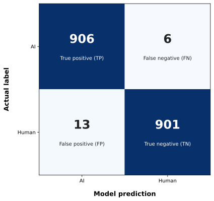

[← 05 · Luna 6 Zero-Shot Baseline](../05_luna-6-baseline/)

# 06 · TF-IDF + Logistic Regression Baseline

A classical machine-learning baseline for classifying German text as **Human**, **AI-generated**, or **AI-assisted**.

The model represents each text using TF-IDF word and bigram features and applies Logistic Regression.

## Setup

| Setting | Value |
|---|---|
| Training samples | 24,986 |
| Validation samples | 2,906 |
| Test samples | 2,737 |
| Maximum features | 200,000 |
| Cross-validation | 3-fold StratifiedGroupKFold |
| Best `C` | 3.0 |
| Best `min_df` | 5 |
| Best `ngram_range` | `(1, 2)` |

## Results

| Metric | Result |
|---|---:|
| Validation accuracy | 91.47% |
| Test accuracy | **91.23%** |
| Test Macro-F1 | **91.22%** |
| Human error | 8.53% |
| AI-generated error | 3.40% |
| AI-assisted error | 14.38% |


The model performs best on **AI-generated text** and struggles most with **AI-assisted text**, especially when it is classified as Human.

## Human vs AI-generated



For the binary Human-vs-AI-generated task, the model reaches **98.96% accuracy** on 1,826 samples.

This shows that the main difficulty in the full three-class task is distinguishing **Human** from **AI-assisted** writing.

## Text Length

Short texts are clearly more difficult:

| Words | Accuracy |
|---|---:|
| ≤70 | 76.94% |
| 71–150 | 91.81% |
| 151–300 | 92.97% |
| 301–500 | **94.74%** |
| 501–750 | 94.18% |
| 750+ | 94.39% |

From around 150 words onward, performance remains relatively stable at approximately **93–95%**.

## Hugging Face

The trained TF-IDF + Logistic Regression model is available on Hugging Face:

[**HassanHijazi/german-ai-text-tfidf-logreg**](https://huggingface.co/HassanHijazi/german-ai-text-tfidf-logreg)

The repository contains the fitted three-class model and metadata and can be loaded directly with `huggingface_hub` and `joblib`.


## How to Run

Make sure the dataset is available at:

```text
data/hf-dataset-3class-full
```

Then start JupyterLab from the repository root:

```bash
jupyter lab
```

Open `06_logreg-baseline/logestic_regression.ipynb` and run the cells in order.

No API key or GPU is required.

---

[← 05_luna-6-baseline](../05_luna-6-baseline/) · [07 · mmBERT-small →](../07_mmbert-small/)