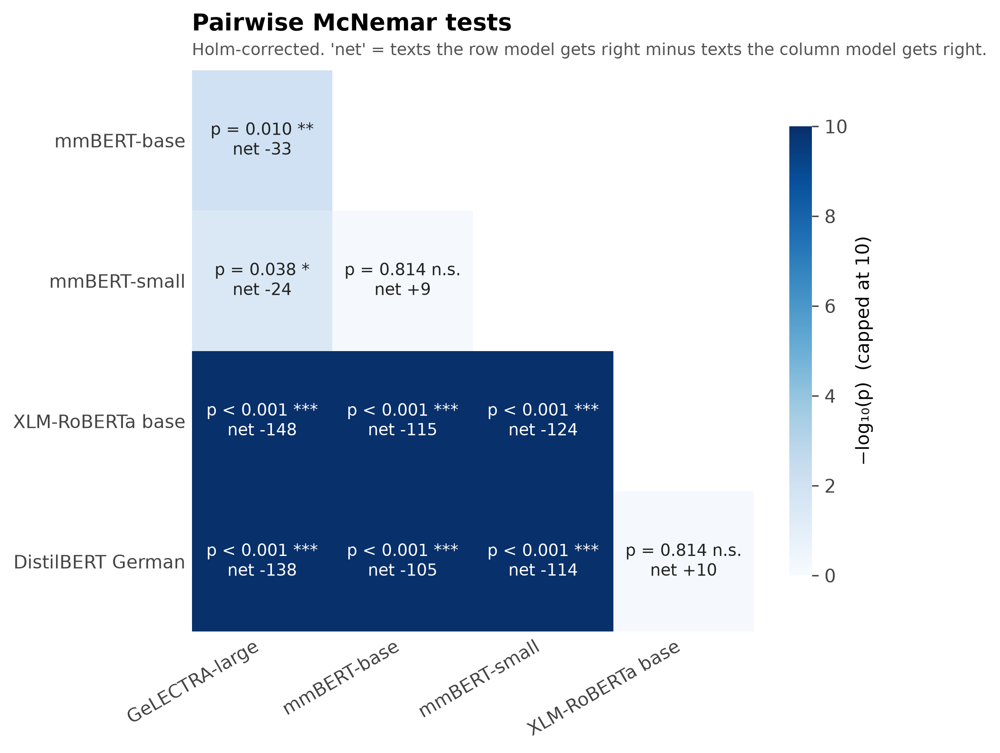
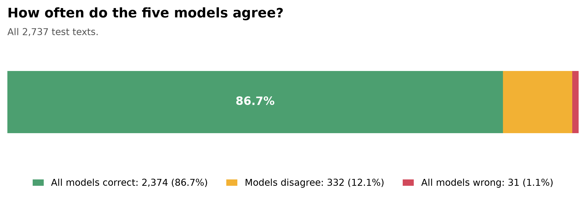
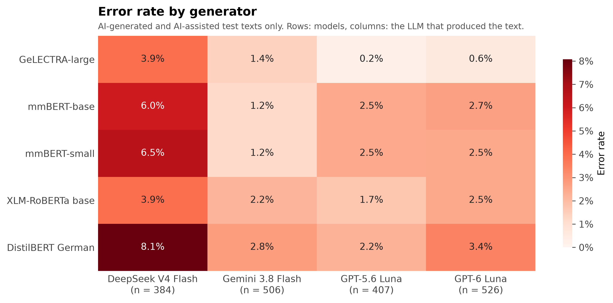
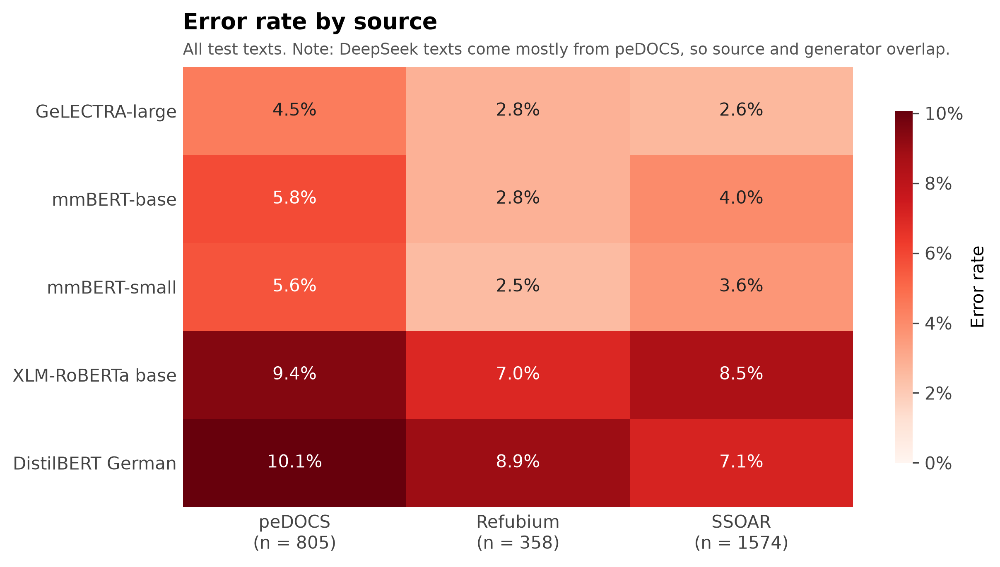
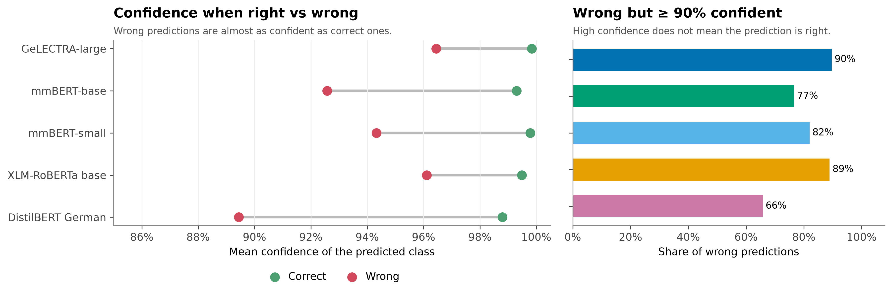
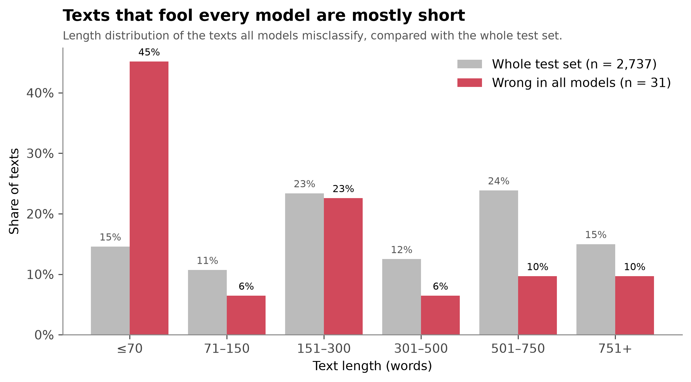

[← 12 · Learning Curves](../12_learning-curves/)

# 13 · Model Comparison

This stage compares the five fine-tuned transformer models **text by text** on the same 2,737 held-out test texts. Instead of only comparing overall scores, it asks:

- Which differences between models are **statistically real**?
- How often do the models **agree**, and which texts fool all of them?
- Which **generators** and **sources** are hardest to detect?
- Can a model's **confidence** be trusted?

Models compared: GeLECTRA-large, mmBERT-base, mmBERT-small, XLM-RoBERTa base and DistilBERT German.

## Key findings

- **Three performance tiers.** GeLECTRA-large is significantly better than every other model. mmBERT-base and mmBERT-small form a second tier, and XLM-RoBERTa base and DistilBERT German a third. Within each lower tier, the differences are not significant.
- **The models mostly agree.** 86.7% of the test texts are classified correctly by all five models, and only 31 texts (1.1%) fool every model.
- **DeepSeek is the hardest generator** for every model, with error rates of 3.9–8.1% on its texts, compared with 0.2–3.4% for the other generators.
- **Confidence is not a reliability signal.** When the models are wrong, they are still highly confident: between 66% and 90% of all wrong predictions have a confidence of 90% or more.
- **Texts that fool every model are mostly short**, and most of them are human-written texts that all models label as AI-assisted.

## Results

### Which differences are real?

<p align="center">
  
</p>

Each pair of models is compared with an exact McNemar test on the texts where exactly one of the two is correct. P-values are Holm-corrected for the ten comparisons.

| Model A | Model B | Only A correct | Only B correct | p (Holm) | Result |
|---|---|---:|---:|---:|---|
| GeLECTRA-large | mmBERT-base | 73 | 40 | 0.010 | GeLECTRA-large better |
| GeLECTRA-large | mmBERT-small | 55 | 31 | 0.038 | GeLECTRA-large better |
| GeLECTRA-large | XLM-RoBERTa base | 171 | 23 | < 0.001 | GeLECTRA-large better |
| GeLECTRA-large | DistilBERT German | 161 | 23 | < 0.001 | GeLECTRA-large better |
| mmBERT-base | mmBERT-small | 42 | 51 | 0.814 | no significant difference |
| mmBERT-base | XLM-RoBERTa base | 152 | 37 | < 0.001 | mmBERT-base better |
| mmBERT-base | DistilBERT German | 146 | 41 | < 0.001 | mmBERT-base better |
| mmBERT-small | XLM-RoBERTa base | 158 | 34 | < 0.001 | mmBERT-small better |
| mmBERT-small | DistilBERT German | 147 | 33 | < 0.001 | mmBERT-small better |
| XLM-RoBERTa base | DistilBERT German | 85 | 95 | 0.814 | no significant difference |

### How often do the models agree?

<p align="center">
  
</p>

| Outcome | Texts | Share |
|---|---:|---:|
| All five models correct | 2,374 | 86.7% |
| Models disagree | 332 | 12.1% |
| All five models wrong | 31 | 1.1% |

### Error rate by generator

<p align="center">
  
</p>

AI-generated and AI-assisted test texts only.

| Generator | Texts | GeLECTRA-large | mmBERT-base | mmBERT-small | XLM-RoBERTa base | DistilBERT German |
|---|---:|---:|---:|---:|---:|---:|
| DeepSeek V4 Flash | 384 | 3.9% | 6.0% | 6.5% | 3.9% | 8.1% |
| Gemini 3.8 Flash | 506 | 1.4% | 1.2% | 1.2% | 2.2% | 2.8% |
| GPT-5.6 Luna | 407 | 0.2% | 2.5% | 2.5% | 1.7% | 2.2% |
| GPT-6 Luna | 526 | 0.6% | 2.7% | 2.5% | 2.5% | 3.4% |

DeepSeek is the hardest generator for every model. GeLECTRA-large is almost error-free on both GPT generators.

### Error rate by source

<p align="center">
  
</p>

All test texts.

| Source | Texts | GeLECTRA-large | mmBERT-base | mmBERT-small | XLM-RoBERTa base | DistilBERT German |
|---|---:|---:|---:|---:|---:|---:|
| peDOCS | 805 | 4.5% | 5.8% | 5.6% | 9.4% | 10.1% |
| Refubium | 358 | 2.8% | 2.8% | 2.5% | 7.0% | 8.9% |
| SSOAR | 1,574 | 2.6% | 4.0% | 3.6% | 8.5% | 7.1% |

peDOCS has the highest error rate for most models. Because most DeepSeek texts were generated from peDOCS documents, source and generator overlap, so this result partly reflects the DeepSeek effect above.

### Confidence when right vs wrong

<p align="center">
  
</p>

| Model | Mean confidence, correct | Mean confidence, wrong | Wrong with ≥ 90% confidence |
|---|---:|---:|---:|
| GeLECTRA-large | 99.8% | 96.5% | 90% |
| mmBERT-base | 99.3% | 92.6% | 77% |
| mmBERT-small | 99.8% | 94.3% | 82% |
| XLM-RoBERTa base | 99.5% | 96.1% | 89% |
| DistilBERT German | 98.8% | 89.4% | 66% |

Wrong predictions are almost as confident as correct ones. A high confidence score should therefore not be read as evidence that a prediction is right.

### Texts that fool every model

<p align="center">
  
</p>

The 31 texts that all five models misclassify are concentrated among short texts compared with the test set as a whole. Most of them are human-written texts that every model labels as AI-assisted: short, formal academic writing and lightly polished AI text look alike to all models.

## Limitations

- **Checkpoints.** The predictions were made with the trained model files stored during the project. For mmBERT-base and DistilBERT German, these files give slightly different test results from the runs reported in the main README, so this comparison reflects those checkpoints.
- **Independence.** McNemar's test treats every text as independent, but a human text and its AI-generated and AI-assisted versions are related. P-values close to 0.05, such as GeLECTRA-large vs mmBERT-small, should be read with caution.
- **Single run.** Each model was trained once. Differences between models may shift slightly with other random seeds.
- **Models covered.** TF-IDF + Logistic Regression and the Luna 6 zero-shot baseline are not part of this comparison.

## Files

```text
13_model-comparison/
├── predictions/                       one CSV per model, one row per test text
│   ├── gelectra-large-test-predictions.csv
│   ├── mmbert-base-test-predictions.csv
│   ├── mmbert-small-test-predictions.csv
│   ├── xlm-roberta-base-test-predictions.csv
│   └── distilbert-german-test-predictions.csv
├── results/                           the six figures (PNG, 300 dpi)
├── scripts/
│   ├── common.py                      shared settings and data loading
│   ├── analyze.py                     statistics (McNemar, agreement, error rates, confidence)
│   ├── plot.py                        figures
│   └── run.py                         runs analyze + plot
└── README.md
```

Each prediction file contains `id`, `label`, `pred`, the three class probabilities (`p_human`, `p_ai_generated`, `p_ai_assisted`), and `word_count`, `source` and `generator_model` for the analyses. Labels: 0 = human, 1 = AI-generated, 2 = AI-assisted.

## Run

No GPU or trained models are needed; the scripts only read the prediction files.

From the repository root:

```bash
pip install -r requirements.txt
cd 13_model-comparison
python scripts/run.py
```

This prints all statistics and saves the six figures to `results/`.

<div align="center">

[← 12 · Learning Curves](../12_learning-curves/) · [Project index](../README.md) · [14 · OOD Model Comparison →](../14_ood-model-comparison/)

</div>
