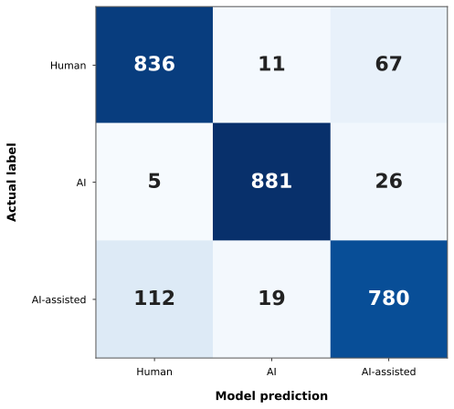
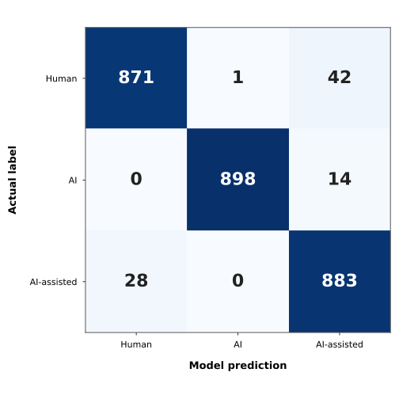

# German AI Text Detector

A three-class research project for distinguishing **human-written**, **AI-generated**, and **AI-assisted** German academic text.

The repository covers the full pipeline: data collection, AI-text generation, dataset construction, model training, error analysis, learning curves, and cross-model comparison.

Unlike a binary Human-vs-AI detector, this project treats **AI-assisted writing** (human text rewritten or polished by a language model) as a separate class.

> **Status:** the dataset pipeline, six supervised models with held-out test results, a zero-shot LLM baseline, length-bias analysis, and learning curves are complete.


## Repository guide

| Stage | Folder | Purpose |
|---:|---|---|
| 01 | [`01_human-data`](./01_human-data/) | Collect and clean German academic human text |
| 02 | [`02_ai-generated-data`](./02_ai-generated-data/) | Generate AI and AI-assisted counterparts |
| 03 | [`03_pangram-test`](./03_pangram-test/) | External Human-vs-AI sanity check |
| 04 | [`04_hf-dataset`](./04_hf-dataset/) | Build the final Hugging Face dataset |
| 05 | [`05_logreg-baseline`](./05_logreg-baseline/) | TF-IDF + Logistic Regression baseline |
| 06 | [`06_mmBERT-small`](./06_mmBERT-small/) | mmBERT-small experiments |
| 07 | [`07_distilbert-german`](./07_distilbert-german/) | DistilBERT German experiments |
| 08 | [`08_mmbert-base`](./08_mmbert-base/) | mmBERT-base experiments |
| 09 | [`09_xlm-roberta-base`](./09_xlm-roberta-base/) | XLM-RoBERTa-base experiments |
| 10 | [`10_Gelectra-large`](./10_Gelectra-large/) | GeLECTRA-large experiments |
| 11 | [`11_luna6-baseline`](./11_luna6-baseline/) | Luna6 zero-shot baseline |
| 12 | [`12_learning-curves`](./12_learning-curves/) | Learning-curve experiments |
| 13 | [`13_model-comparison`](./13_model-comparison/) | Cross-model comparison |
| 14 | [`14_ood-model-comparison`](./14_ood-model-comparison/) | Out-of-distribution model comparison |


Each stage has its own README with methods, code, and outputs.


## At a glance

- **30,629 texts** in the final three-class dataset
- **10,227 human texts** from **4,121 source documents** (SSOAR, peDOCS, Refubium)
- AI and AI-assisted texts from **four generator families**
- Document-level train / validation / test splits
- **Six supervised classifiers** and **one zero-shot LLM baseline**
- Evaluation with confusion matrices, class-specific results, length analysis, and learning curves

## Dataset

### Human texts

| Source   | Type                                          |
| -------- | --------------------------------------------- |
| SSOAR    | Open-access repository for social sciences    |
| peDOCS   | Open-access repository for education research |
| Refubium | Freie Universität Berlin repository           |

Only openly licensed material was kept (CC BY, CC BY-SA, CC0, Public Domain). The texts come from German academic documents published before the widespread use of generative AI. Source and license information is stored per sample.

### Text construction

Documents were cut into **sentence-complete chunks** with target lengths of about 50, 150, 300, 600, and 1,000 words. At most **three chunks per document** were used, and all chunks of one document stay in the same split.

### AI-generated and AI-assisted texts

For most human samples, an AI-generated and an AI-assisted counterpart were created with the prompts in this repository.

- **AI-assisted:** the model receives the human text and rewrites or polishes it while preserving meaning, argument, order of ideas, citations, and numbers.
- **AI-generated:** the model writes a new academic text on the same topic with its own wording and structure.
- **DeepSeek exception:** the first DeepSeek setup paraphrased the human source too closely. For DeepSeek, the final AI-generated strategy first extracts three short topics from the human text and then generates a new text from those topics only.

| Generator         | AI-generated | AI-assisted |
| ----------------- | -----------: | ----------: |
| GPT-5.6 Luna      |        2,491 |       2,489 |
| Gemini 3.8 Flash  |        2,494 |       2,493 |
| DeepSeek V4 Flash |        2,497 |       2,500 |
| GPT-6 Luna        |        2,721 |       2,718 |

### Class and split sizes

| Class        |    Samples |
| ------------ | ---------: |
| Human        |     10,227 |
| AI-generated |     10,203 |
| AI-assisted  |     10,199 |
| **Total**    | **30,629** |

| Split      | Human |    AI | AI-assisted |  Total |
| ---------- | ----: | ----: | ----------: | -----: |
| Train      | 8,342 | 8,324 |       8,320 | 24,986 |
| Validation |   971 |   967 |         968 |  2,906 |
| Test       |   914 |   912 |         911 |  2,737 |

Related texts (the same source document and everything derived from it) always stay in the same split, which reduces source leakage.

## Models

| Model                        | Type                   |
| ---------------------------- | ---------------------- |
| TF-IDF + Logistic Regression | Classical baseline     |
| DistilBERT German            | Transformer            |
| mmBERT-small                 | Transformer            |
| mmBERT-base                  | Transformer            |
| XLM-RoBERTa base             | Transformer            |
| GeLECTRA-large               | Transformer            |
| Luna 6 (via Azure OpenAI)    | Zero-shot LLM baseline |


## Results

### Learning curves

Each supervised model was trained on 1%, 5%, 12%, 17.5%, 25%, 50%, and 100% of the training data. Validation accuracy at 100%:

| Model                        | Validation accuracy |
| ---------------------------- | ------------------: |
| **mmBERT-base**              |          **96.25%** |
| GeLECTRA-large               |              95.84% |
| mmBERT-small                 |              94.84% |
| XLM-RoBERTa base             |              91.60% |
| TF-IDF + Logistic Regression |              91.33% |
| DistilBERT German            |              90.50% |

These are **validation** results from the learning-curve experiments, not final held-out test results.

### Final results

The six supervised models were evaluated on the held-out test set of 2,737 texts (914 Human, 912 AI-generated, 911 AI-assisted). Luna6 was evaluated separately on a balanced sample of approximately 9,000 texts. "Human flagged as AI or AI-assisted" is the share of human texts predicted as anything other than Human.

| Model | Accuracy | Macro-F1 | Human flagged as AI or AI-assisted |
|---|---:|---:|---:|
| **GeLECTRA-large** | **96.89%** | **96.91%** | **4.70%** |
| mmBERT-base | 96.64% | 96.65% | 5.58% |
| mmBERT-small | 95.94% | 95.95% | 6.24% |
| TF-IDF + Logistic Regression | 91.23% | 91.22% | 8.53% |
| XLM-RoBERTa base | 91.09% | 91.03% | 21.66% |
| DistilBERT German | 90.83% | 90.82% | 19.91% |
| Luna6 zero-shot* | 57.03% | 54.96% | 4.78% |

\* Luna6 was not fine-tuned and was evaluated on a separate balanced sample of approximately 9,000 texts, so its result is shown as a reference rather than a directly comparable test score.

### Error rate per class

| Model | Human error | AI-generated error | AI-assisted error |
|---|---:|---:|---:|
| GeLECTRA-large | 4.70% | 1.54% | 3.07% |
| mmBERT-base | 5.58% | 0.99% | 3.51% |
| mmBERT-small | 6.24% | 0.99% | 4.94% |
| TF-IDF + Logistic Regression | 8.53% | 3.40% | 14.38% |
| XLM-RoBERTa base | 21.66% | 0.88% | 4.17% |
| DistilBERT German | 19.91% | 2.08% | 5.49% |
| Luna6 zero-shot* | 4.78% | 47.53% | 76.53% |


---

## Error rate by text length

The following table reports overall classification error across all three classes for different text-length bins.

`n` denotes the number of held-out test samples in each bin.

| Text length | n | TF-IDF + Logistic Regression | DistilBERT German | XLM-RoBERTa base | mmBERT-small | mmBERT-base | GeLECTRA-large |
|---|---:|---:|---:|---:|---:|---:|---:|
| ≤70 | 399 | 23.06% | 16.79% | 17.04% | 12.03% | 10.53% | **9.27%** |
| 71–150 | 293 | 8.19% | 9.90% | 8.87% | 4.44% | 3.41% | **2.73%** |
| 151–300 | 640 | 7.03% | 7.81% | 8.28% | 4.38% | 3.12% | **2.34%** |
| 301–500 | 342 | 5.26% | 6.14% | 5.56% | 1.17% | **0.58%** | 1.75% |
| 501–750 | 653 | 5.82% | 7.50% | 6.43% | 1.99% | **1.53%** | 2.14% |
| 750+ | 410 | 5.61% | 8.54% | 8.78% | **1.22%** | 1.95% | **1.22%** |

The clearest pattern is that **very short texts are substantially harder to classify**.


## Confusion matrices

Three-class confusion matrices for the TF-IDF baseline and GeLECTRA-large, the model with the highest held-out test accuracy, are shown below.

| TF-IDF + Logistic Regression | GeLECTRA-large |
| :---: | :---: |
|  |  |


### External sanity check (Pangram)

A random sample of 50 human and 50 AI-generated texts, from about 35 to 1,143 words and covering all four generators, was checked with Pangram. All 100 were classified correctly. The sample is small and AI-assisted texts were not included, so this is a sanity check on the data and not a benchmark.

## Key findings

1. **The top three models are close.** GeLECTRA-large (96.89%), mmBERT-base (96.64%), and mmBERT-small (95.94%) lead on the held-out test set. The gap between GeLECTRA-large and mmBERT-base is only 0.25 percentage points. On the learning-curve validation results, mmBERT-base was ahead at 96.25% versus 95.84% for GeLECTRA-large.

2. **A small model is competitive.** mmBERT-small reaches 95.94% test accuracy and remains close to the two strongest larger transformer models while outperforming XLM-RoBERTa base, DistilBERT German, and the TF-IDF baseline.

3. **Accuracy hides large differences in human error.** XLM-RoBERTa base and DistilBERT German reach about 91% accuracy but misclassify 21.66% and 19.91% of Human texts. The TF-IDF baseline has similar overall accuracy but a substantially lower Human error rate of 8.53%.

4. **Fine-tuning is important.** The zero-shot Luna6 baseline reaches 57.03% three-class accuracy. It identifies Human text reliably but has much higher error rates for AI-generated (47.53%) and AI-assisted (76.53%) text. Because Luna6 was evaluated on a separate sample and depends on the chosen prompt, it is treated as a reference baseline.

5. **Fully AI-generated text is generally the easiest class for the supervised models.** AI-generated error ranges from 0.88% to 3.40%. For all five fine-tuned transformer models, Human text has the highest class-specific error rate. For TF-IDF + Logistic Regression, AI-assisted text is the most difficult class.

6. **The baseline struggles most with AI-assisted text.** Its AI-assisted error rate is 14.38%, while the fine-tuned transformer models reduce this to between 3.07% and 5.49%.

7. **Generation method matters.** The Pangram check exposed that the original DeepSeek setup produced near-paraphrases of the Human source, which led to the topics-only strategy.

8. **Validation and held-out test results are broadly consistent.** The strongest models remain near the top across both evaluations, although the exact ordering changes slightly.

9. **Text length matters.** Across all supervised models, texts of 70 words or fewer are the most difficult length group.

## Evaluation

The repository reports more than accuracy: three-class confusion matrices, class-specific performance, prediction confidence, length-bias analysis, training vs. validation accuracy (generalization gap), learning curves, and the zero-shot LLM comparison.

## Limitations

- **Domain.** All texts are German academic writing. Results should not be assumed to transfer to other genres, registers, or languages.
- **Generation prompts.** The AI texts were produced with prompts asking for polished academic German. Style and polish may therefore act as a signal in addition to authorship. A test on plainer or differently styled text from other generators is planned.
- **Generators.** Four model families are covered, not every current or future model.
- **AI-assisted class.** Real AI-assisted writing varies widely. This class represents one specific form of AI rewriting and polishing.
- - **Short texts.** Texts of 70 words or fewer are substantially harder to classify.
- **Sanity check.** The Pangram test is small and excludes AI-assisted text.


## Reproduce

Install the required packages:

```bash
pip install -r requirements.txt


## Reproduction guide

The repository is organized as a numbered workflow, from data collection and AI-text generation through dataset construction, model training, learning curves, and final model comparison.

For a full reproduction, run the stages in numerical order. Individual experiments can also be reproduced independently if the prepared Hugging Face dataset and the required model artifacts are already available.

Rebuilding the complete pipeline requires considerably more compute and time than running a single notebook. Several stages depend on external language-model APIs, large-scale text generation, and GPU-based transformer training.

For most users, the provided dataset, saved model artifacts, and result files offer the fastest way to inspect or reproduce the main experiments without rerunning the entire pipeline.