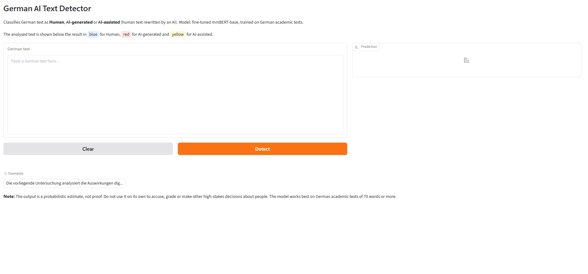

# German AI Text Detector

Detects whether a German text is **human-written**, **AI-generated**, or **AI-assisted** (human text rewritten by an AI).

Most detectors only separate "human" from "AI". This project adds a third class for **AI-assisted** writing, because polished human text is the hardest and most common case in practice.

<p align="center">
  
</p>
<p align="center"><i>The same passage, written by a human, polished by an AI, and generated by an AI.</i></p>

<p align="center">
  <b>96.9%</b> test accuracy &nbsp;·&nbsp; <b>96.6%</b> on unseen text domains &nbsp;·&nbsp; <b>30,629</b> German texts &nbsp;·&nbsp; <b>6</b> models compared
</p>

---

## Contents

- [Quick start](#quick-start)
- [Results](#results)
- [Key findings](#key-findings)
- [Dataset](#dataset)
- [Models](#models)
- [Repository structure](#repository-structure)
- [Limitations](#limitations)
- [Authors and license](#authors-and-license)

---

## Quick start

### Try the detector (web app)

Runs locally with Docker. No GPU needed.

```bash
git clone https://github.com/HassanHijaze/german-ai-text-detector-from-scratch.git
cd german-ai-text-detector-from-scratch/15_deployment
docker build -t german-ai-text-detector .
docker run -p 7860:7860 german-ai-text-detector
```

Open **http://localhost:7860**, paste a German text, and click **Detect**. Details: [15 · Deployment](./15_deployment/).

### Use a model in Python

All trained models are public on Hugging Face.

```python
from transformers import pipeline

detector = pipeline("text-classification", model="HassanHijazi/german-ai-text-mmbert-base", top_k=None)
print(detector("Ihr deutscher Text …", truncation=True, max_length=512))
```

Labels: `0` = human, `1` = AI-generated, `2` = AI-assisted.

---

## Results

All models were evaluated on the same **held-out test set (2,737 texts)**. The supervised models were also tested on **869 out-of-distribution (OOD) texts** from domains never seen in training (Wikipedia, Wikinews, Wikivoyage, Wikibooks).

| Model | Test accuracy | Macro-F1 | OOD accuracy | Human texts wrongly flagged |
|---|---:|---:|---:|---:|
| GeLECTRA-large | **96.89%** | **96.91%** | 96.32% | 4.70% |
| mmBERT-base | 96.64% | 96.65% | **96.55%** | 5.58% |
| mmBERT-small | 95.94% | 95.95% | 81.13% | 6.24% |
| TF-IDF + Logistic Regression | 91.23% | 91.22% | 79.40% | 8.53% |
| XLM-RoBERTa base | 91.09% | 91.03% | 91.83% | 21.66% |
| DistilBERT German | 90.83% | 90.82% | 89.41% | 19.91% |
| Luna 6 (zero-shot LLM) | 55.64% | 50.83% | — | 1.42%¹ |

**Human texts wrongly flagged:** share of human-written test texts classified as AI-generated or AI-assisted.
¹ Low only because Luna 6 rarely predicts AI at all; it misses most AI texts.

**Recommended model: mmBERT-base.** GeLECTRA-large is slightly stronger on the test set, but mmBERT-base generalizes best to new kinds of text, which matters most in real use. The web app uses mmBERT-base.

<details>
<summary><b>Error rate per class</b></summary>

| Model | Human | AI-generated | AI-assisted |
|---|---:|---:|---:|
| GeLECTRA-large | 4.70% | 1.54% | 3.07% |
| mmBERT-base | 5.58% | 0.99% | 3.51% |
| mmBERT-small | 6.24% | 0.99% | 4.94% |
| TF-IDF + Logistic Regression | 8.53% | 3.40% | 14.38% |
| XLM-RoBERTa base | 21.66% | 0.88% | 4.17% |
| DistilBERT German | 19.91% | 2.08% | 5.49% |
| Luna 6 (zero-shot LLM) | 1.42% | 40.57% | 91.22% |

</details>

<details>
<summary><b>Error rate by text length</b></summary>

Overall error across all three classes. `n` = number of test texts in each length range.

| Words | n | GeLECTRA-large | mmBERT-base | mmBERT-small | XLM-RoBERTa base | DistilBERT German | TF-IDF + LogReg | Luna 6 |
|---|---:|---:|---:|---:|---:|---:|---:|---:|
| ≤70 | 399 | **9.27%** | 10.53% | 12.03% | 17.04% | 16.79% | 23.06% | 44.11% |
| 71–150 | 293 | **2.73%** | 3.41% | 4.44% | 8.87% | 9.90% | 8.19% | 39.59% |
| 151–300 | 640 | **2.34%** | 3.12% | 4.38% | 8.28% | 7.81% | 7.03% | 42.34% |
| 301–500 | 342 | 1.75% | **0.58%** | 1.17% | 5.56% | 6.14% | 5.26% | 48.83% |
| 501–750 | 653 | 2.14% | **1.53%** | 1.99% | 6.43% | 7.50% | 5.82% | 44.87% |
| 751+ | 410 | **1.22%** | 1.95% | **1.22%** | 8.78% | 8.54% | 5.61% | 46.59% |

</details>

<details>
<summary><b>Learning curves (validation accuracy with 100% of the training data)</b></summary>

Each model was trained on 1%, 5%, 12%, 17.5%, 25%, 50% and 100% of the training data. Full curves: [12 · Learning Curves](./12_learning-curves/).

| Model | Validation accuracy |
|---|---:|
| mmBERT-base | **96.25%** |
| GeLECTRA-large | 95.84% |
| mmBERT-small | 94.84% |
| XLM-RoBERTa base | 91.60% |
| TF-IDF + Logistic Regression | 91.33% |
| DistilBERT German | 90.50% |

These are validation results, not test results.

</details>

More analyses: [13 · Model Comparison](./13_model-comparison/) (significance tests, errors by generator and source, confidence) and [14 · OOD Model Comparison](./14_ood-model-comparison/).

---

## Key findings

1. **GeLECTRA-large and mmBERT-base are the best models.** GeLECTRA-large leads on the test set; mmBERT-base keeps its accuracy on unseen domains.
2. **Test accuracy does not guarantee robustness.** mmBERT-small drops from 95.9% on the test set to 81.1% on unseen domains.
3. **Short texts are hard.** Every model makes its most errors on texts of 70 words or fewer.
4. **AI-assisted text is harder to detect than AI-generated text**, because it keeps the human author's content and structure.
5. **Some generators are harder than others.** Texts from DeepSeek V4 Flash are missed most often by every model.
6. **Confidence is not proof.** When the models are wrong, they are usually still more than 90% confident.

---

## Dataset

**30,629 German academic texts**, balanced across three classes:

| Class | Texts | How it was made |
|---|---:|---|
| Human | 10,227 | Openly licensed academic documents from **SSOAR, peDOCS and Refubium**, published before generative AI was widespread |
| AI-generated | 10,203 | A new text on the same topic, written from scratch by an LLM |
| AI-assisted | 10,199 | The human text, rewritten and polished by an LLM while keeping its meaning and structure |

AI texts were generated with **GPT-5.6 Luna, GPT-6 Luna, Gemini 3.8 Flash and DeepSeek V4 Flash**.

| Split | Texts |
|---|---:|
| Train | 24,986 |
| Validation | 2,906 |
| Test | 2,737 |

The data was split **by document**, so texts from the same source document never appear in two splits.

**OOD set:** 869 texts (290 human, 289 AI-generated, 290 AI-assisted). The human texts come from German Wikipedia, Wikinews, Wikivoyage and Wikibooks, which are encyclopedic, news, travel and instructional writing not present in training.

---

## Models

| Model | Type | Parameters | Hugging Face |
|---|---|---:|---|
| TF-IDF + Logistic Regression | Classical baseline | ≤ 0.6M² | [model](https://huggingface.co/HassanHijazi/german-ai-text-tfidf-logreg) |
| DistilBERT German | Transformer | ~67M | [model](https://huggingface.co/HassanHijazi/german-ai-text-distilbert-german) |
| mmBERT-small | Transformer | 140M | [model](https://huggingface.co/HassanHijazi/german-ai-text-mmbert-small) |
| XLM-RoBERTa base | Transformer | ~278M | [model](https://huggingface.co/HassanHijazi/german-ai-text-xlm-roberta-base) |
| mmBERT-base | Transformer | 307M | [model](https://huggingface.co/HassanHijazi/german-ai-text-mmbert-base) |
| GeLECTRA-large | Transformer | ~335M | [model](https://huggingface.co/HassanHijazi/german-ai-text-gelectra-large) |
| Luna 6 (OpenAI API) | Zero-shot LLM | not disclosed | — |

² Upper bound: at most 200,000 TF-IDF features (word unigrams and bigrams) × 3 classes, plus 3 intercepts.

Base models: [DistilBERT German](https://huggingface.co/distilbert/distilbert-base-german-cased) · [mmBERT-small](https://huggingface.co/jhu-clsp/mmBERT-small) · [XLM-RoBERTa base](https://huggingface.co/FacebookAI/xlm-roberta-base) · [mmBERT-base](https://huggingface.co/jhu-clsp/mmBERT-base) · [GeLECTRA-large](https://huggingface.co/deepset/gelectra-large)

---

## Repository structure

The project is organized as numbered stages. Each folder has its own README with details and run instructions.

| Stage | Folder | What it does |
|---:|---|---|
| **Data** | | |
| 01 | [`01_human-data`](./01_human-data/) | Collect and clean German academic human texts |
| 02 | [`02_ai-generated-data`](./02_ai-generated-data/) | Generate AI-generated and AI-assisted texts |
| 03 | [`03_pangram-test`](./03_pangram-test/) | External Human-vs-AI sanity check |
| 04 | [`04_hf-dataset`](./04_hf-dataset/) | Build the final dataset |
| **Baselines** | | |
| 05 | [`05_luna-6-baseline`](./05_luna-6-baseline/) | Zero-shot LLM baseline (Luna 6) |
| 06 | [`06_logreg-baseline`](./06_logreg-baseline/) | TF-IDF + Logistic Regression baseline |
| **Transformers** | | |
| 07 | [`07_fine-tuning`](./07_fine-tuning/) | Fine-tune and evaluate the five transformer models |
| **Evaluation** | | |
| 12 | [`12_learning-curves`](./12_learning-curves/) | Performance across training-set sizes |
| 13 | [`13_model-comparison`](./13_model-comparison/) | Text-level comparison on the test set |
| 14 | [`14_ood-model-comparison`](./14_ood-model-comparison/) | Generalization to unseen domains |
| **Deployment** | | |
| 15 | [`15_deployment`](./15_deployment/) | Run the detector as a Docker web app |

### Running the stages

```bash
git clone https://github.com/HassanHijaze/german-ai-text-detector-from-scratch.git
cd german-ai-text-detector-from-scratch
pip install -r requirements.txt
```

Copy `.env.example` to `.env` and add the API keys needed for the stages you want to run (AI text generation and the zero-shot baseline). The dataset is private, so stages that load it need access permission. The trained models are public.

---

## Limitations

- **Domain:** trained on German academic texts (mainly social sciences and education). Other kinds of text may be classified less reliably.
- **Generators:** AI texts come from four LLMs. Newer or different models may be harder to detect.
- **AI-assisted** here means a full rewrite of a human text by an AI. Other forms of AI help (e.g. editing single sentences) were not studied.
- **Length:** only the first 512 tokens of a text are used, and texts under 70 words are much less reliable.
- **Not proof:** the output is a probabilistic estimate. It must not be used on its own to accuse, grade or make other high-stakes decisions about people.

---

## Authors and license

- [Hassan Hijazi](https://github.com/HassanHijaze)
- [Ali Issa](https://github.com/aliissa824)

The source code is released under the [MIT License](LICENSE). Datasets, source texts, pretrained models and other third-party resources remain subject to their own licenses and terms of use.